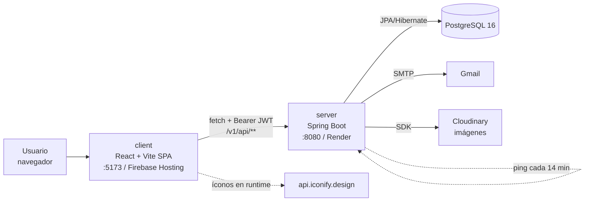
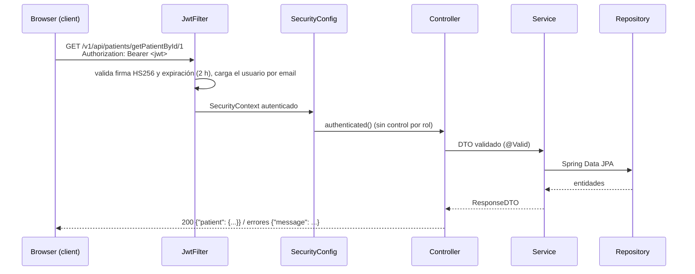
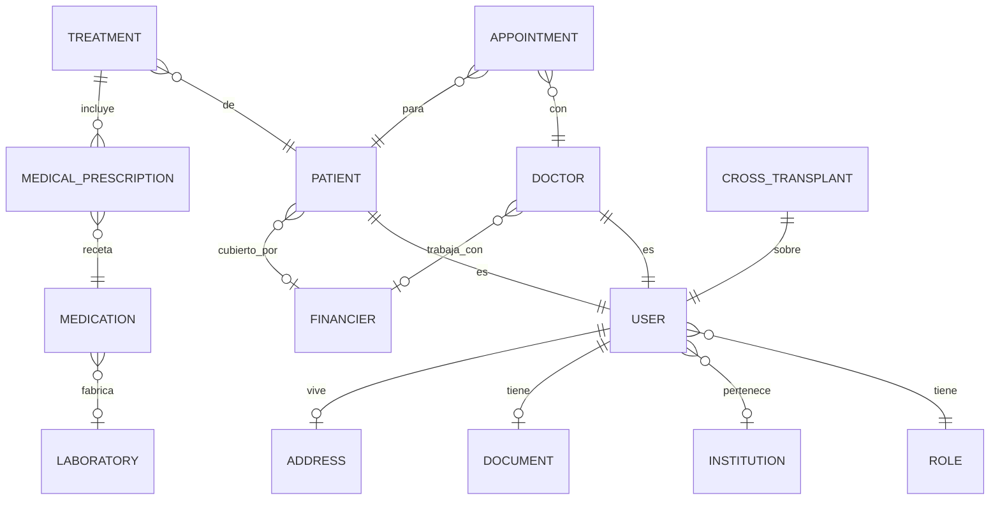

# Arquitectura

## Componentes (actual)

- **client** (`client/`): SPA sin SSR. Rutas por rol en `Router/Routers.jsx`; sesión en `context/DoctorContext.jsx` (`localStorage["authData"]`); HTTP en `services/*.js` (URL de producción fija hasta T-003).
- **server** (`server/`): API REST stateless. Capas `controllers → services (impl) → repositories → entities`, DTOs en `dtos/`. Seed al arrancar (`data/`). OpenAPI en `/v3/api-docs`, Swagger UI en `/swagger-ui`.
- **DB**: esquema generado por Hibernate (`ddl-auto=create-drop`), sin migraciones versionadas.

## Flujo de una request

## Autenticación
1. `POST /v1/api/auth/login` (público) con email y contraseña → `LoginServiceImpl` autentica con `AuthenticationManager` (BCrypt) → devuelve `{ data: { token, role, id }, message }`.
2. El front guarda `authData` en `localStorage` y redirige según `role` (`DOCTOR` → `/doctorPatient`, `PATIENT` → `/patient`, `ADMIN` → `/admin`).
3. Cada request lleva `Authorization: Bearer <jwt>`; `JwtFilter` (`config/jwt/JwtFilter.java`) arma el `SecurityContext`.
4. Públicos: `/v1/api/auth/*` (login **y** `admin-register`), `/v1/api/render/*`, Swagger (`config/security/SecurityConfig.java:38-45`).
5. ⚠️ El back no autoriza por rol: cualquier usuario autenticado accede a todo (T-009). La restricción por rol hoy existe solo en el front (`Router/PrivateRoute.jsx`).

## Modelo de datos principal

- Roles seed: `ADMIN`, `DOCTOR`, `PATIENT` (usados por el front) y `LABORATORY`, `FINANCIER`, `PHARMACY`, `PARENT_GUARDIAN`, `HEALTH_CENTER` (sin pantallas) (`data/DataLoaderRole.java`).
- Doctor: especialidades, días y horarios disponibles como `@ElementCollection` de enums (`enumerations/`).
- Paciente: historia clínica y patologías como colecciones de texto.
- `CrossTransplant`: entidad sin endpoints todavía.
- Diagrama ER original del equipo: [PDF en Drive](https://drive.google.com/file/d/1EWk72gLBysvzqzxzEhsiv4TPakScYo5L/view?usp=sharing).

## Endpoints principales (71 operaciones; lista completa en Swagger)

"Pantalla que lo usa": `grep` de `client/src/services/*.js` y de sus llamadas en `client/src/Components` (2026-10-10). Rutas relativas a `client/src/Components/`; "vía contexto" = la llamada está en `context/DoctorContext.jsx`.

| Recurso | Base | Operaciones | Pantalla que lo usa |
|---|---|---|---|
| Auth | `/v1/api/auth` | `POST /login`, `POST /admin-register` | login → `Login/Login.jsx` (vía contexto) · admin-register → ninguna |
| Usuarios | `/v1/api/users` | getAll, getById, update, updateEmail/Password/Document, addDocumentImages, deactivate, delete | ninguna |
| Doctores | `/v1/api/doctors` | create, getAllDoctors, getDoctorById, updateDoctor, deactivateDoctor | getAllDoctors → `Admin/Doctors.jsx`, `Patient/Turn/NewTurn/NewTurn.jsx` (vía contexto) · getDoctorById → `Doctor/DoctorConfiguration/` (vía contexto) · resto → ninguna |
| Pacientes | `/v1/api/patients` | create, getAll/ById, update, add/updateMedicalHistory, add/updatePathology, uploadFile, getPatientFiles, deactivate | create → `Admin/AddPatientForm.jsx:60` (`fetch` directo) · getPatientById → `Patient/HomePatient/`, `Patient/ProfileConfiguration/`, `Patient/Treatment/Plans/PlanMedication.jsx`, `Doctor/PreviousConsultation/`, `Doctor/PatientRecord/MedicalHistory/` (vía contexto) · resto → ninguna |
| Turnos | `/v1/api/appointments` | createAppointment, getAll, getById, getByDoctorId, getByPatientId, update, deactivate | create → `Patient/Turn/NewTurn/` · getByPatientId → `Patient/Turn/Turn.jsx`, `Patient/Turn/TurnCalendar/`, `Patient/Turn/NewTurn/`, `Doctor/PreviousConsultation/` · getByDoctorId → `Doctor/PatientList/`, `Doctor/Patients/` · deactivate → `Patient/Turn/Turn.jsx` |
| Tratamientos | `/v1/api/treatments` | addTreatmentToPatient, addMedicalPrescription, getAll/ById, update, deactivate | ninguna (planes de tratamiento con datos mock) |
| Recetas | `/v1/api/medical-prescriptions` | CRUD + deactivate | ninguna |
| Catálogos | `/v1/api/{medications,laboratories,financiers,institutions,roles}` | CRUD + deactivate | ninguna |
| Imágenes | `/v1/api/images/upload` | subida a Cloudinary | ninguna |
| Health | `/v1/api/render/health` | público, texto plano | ninguna (lo usa `ServerWakeUpScheduler`) |

Convención: rutas con verbo (`/getAllDoctors`), respuestas `Map` con `message` + dato.

## Arquitectura objetivo (resumen; decisiones en ADRs)
- PostgreSQL como única base, con **Flyway** para el esquema y seed solo en perfil `dev`/`demo` ([ADR 0001](adr/0001-postgresql-as-only-database.md)).
- Tests de integración con **Testcontainers** ([ADR 0002](adr/0002-testcontainers-postgresql-for-tests.md)).
- Actualización Spring Boot 3.3 → 3.5 → 4.x protegida por la red de tests ([ADR 0003](adr/0003-upgrade-path-spring-boot.md)).
- Autorización por rol en el back (`@PreAuthorize`), errores con `ProblemDetail`, URL de API por variable en el front.
